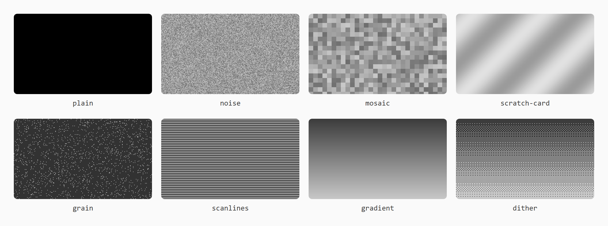
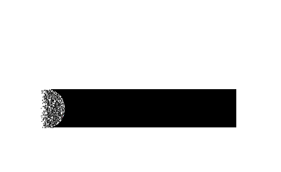
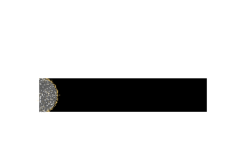

# veil

A React cover that hides its content until the pointer scratches it away.

[](https://www.npmjs.com/package/@-3-/veil)
[](./LICENSE)

```bash
pnpm add @-3-/veil
```

```tsx
import { Veil } from "@-3-/veil";

<Veil texture="scratch-card" effect="ash">
  <div style={{ width: 300, height: 120 }}>You won!</div>
</Veil>;
```

See the [package README](./packages/veil/README.md) for every prop, texture and effect, or try them all in the [demo](https://charmingjae.github.io/veil/).

## Textures



## Effects

| `float` | `sand` | `scatter` | `dissolve` |
| :-: | :-: | :-: | :-: |
|  |  |  |  |
| **`wind`** | **`snow`** | **`sparkle`** | **`ash`** |
|  |  |  |  |

## Repository

| Path | What it is |
| --- | --- |
| [`packages/veil`](./packages/veil) | The `@-3-/veil` package published to npm |
| [`apps/playground`](./apps/playground) | A Next.js app for trying every option, with the matching code to copy |

The playground uses the package through the pnpm workspace, so it always runs the code in `packages/veil`.

## Development

Requires Node.js 24 or later and pnpm (the version in `package.json` is fetched automatically).

```bash
pnpm install
pnpm dev     # builds the package, then rebuilds it on change while the playground runs
pnpm build   # builds the package, then the playground
pnpm lint    # Biome on everything, Steiger on the playground
pnpm typecheck   # builds the package, then type-checks it and the playground
pnpm capture:textures   # rebuilds docs/images/textures.png from the playground
pnpm capture:effects    # rebuilds docs/images/effects/*.gif from the playground
```

The first capture on a machine needs `pnpm exec playwright install chromium`.

## License

[MIT](./LICENSE)
